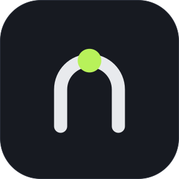

<p align="center">
  
</p>
<h1 align="center">nexo</h1>
<p align="center"><strong>Find your projects, containers, and coding agents in one fast terminal UI.</strong></p>

<p align="center">
  <a href="https://github.com/vieitesss/nexo/releases"></a>
  <a href="https://github.com/vieitesss/nexo/actions/workflows/ci.yml"></a>
  <a href="LICENSE"></a>
  <a href="go.mod"></a>
  
  <a href="https://github.com/vieitesss/nexo/commits/main"></a>
</p>

<p align="center">
  <a href="#features">Features</a> ·
  <a href="#install">Install</a> ·
  <a href="#usage">Usage</a> ·
  <a href="#configuration">Configuration</a> ·
  <a href="#backends">Backends</a> ·
  <a href="#contributing">Contributing</a>
</p>

<!-- Demo: record assets/demo.gif with `vhs assets/demo.tape`, then uncomment.
<p align="center">
  
</p>
-->

nexo is a Go CLI and terminal UI for moving between project candidates, open
containers, remote containers, and coding-agent panes. It drives exactly one
selected backend per invocation: tmux or Herdr in v1. The place picker and
agent navigator are built with Bubble Tea and use nexo's own fuzzy ranking.

## Features

<table>
  <tr>
    <td valign="top" width="33%"><h4>📍 Place picker</h4><p>Search project candidates and open local or remote containers from one grouped picker. Git context, previews, agent dots, rename, and batch close actions stay in the same view.</p></td>
    <td valign="top" width="33%"><h4>🌐 Remote machines and proxies</h4><p>List configured machines over SSH and open tmux containers through a local tmux or Herdr proxy. For a Herdr remote, nexo saves the machine if needed and points you to the container under it in Herdr's sidebar. SSH, mosh, and Eternal Terminal attachment transports are supported.</p></td>
    <td valign="top" width="33%"><h4>🧭 Agent navigator</h4><p>Find every detected agent pane, with unseen stopped agents first. Search by harness, target, or branch, then focus the exact pane.</p></td>
  </tr>
  <tr>
    <td valign="top" width="33%"><h4>🔔 Notifications</h4><p>The tmux watcher sends durable working-to-stopped desktop notifications with optional sound. Herdr's native agent state and notification settings remain authoritative.</p></td>
    <td valign="top" width="33%"><h4>🌿 Git context</h4><p>Project rows can show branch or short SHA identity, additions and deletions, dirty state, cached local ahead/behind divergence without fetching, and a colour-coded pull request number when <code>gh</code> and a GitHub upstream are available.</p></td>
    <td valign="top" width="33%"><h4>⚙️ Two backends</h4><p>Use tmux or Herdr through one backend-neutral CLI and one TOML configuration. Thin adapters call the binary while each multiplexer keeps its native capabilities.</p></td>
  </tr>
</table>

## How it works

nexo chooses one backend in this order: the `--backend` flag, the `backend`
config key, then auto-detection of the inner multiplexer. It never aggregates
multiplexers or controls one from another. The place picker answers “where do I
go?”; the agent navigator answers “who needs me?”. Both are full-screen Bubble
Tea programs with asynchronous discovery and no `fzf` dependency.

Agent rows use one dot and a state that is easy to scan:

| Dot | State | Meaning |
| --- | --- | --- |
| 🟡 yellow | `working` | The agent's working indicator is live. |
| 🔴 red | `stopped` / unseen | The agent stopped and its exact pane has not been focused yet. |
| 🟢 green | `stopped` / seen | The stopped agent has been seen. |

Backends are native-first: when a multiplexer provides a capability, nexo uses
it; nexo only fills gaps such as tmux screen polling or remote attachment.
See the settled design in [CONTEXT.md](CONTEXT.md) and
[docs/adr](docs/adr). For repeatable startup measurements, see
[docs/startup.md](docs/startup.md).

## Install

> The repository is private and no release has been published yet. While it is
> private, a Go install needs `GOPRIVATE` and authenticated Git access (for
> example an SSH key or `gh auth login`). Once the repository is public, the
> plain `go install` and the Homebrew and release-binary methods below apply;
> see [docs/release.md](docs/release.md).

<details open>
<summary><strong>Homebrew (after the first release)</strong></summary>

```sh
brew install vieitesss/tap/nexo
```

</details>

<details open>
<summary><strong>Go install</strong></summary>

While the repository is private, bypass the public module proxy with
`GOPRIVATE` and rely on your authenticated Git access:

```sh
GOPRIVATE=github.com/vieitesss/nexo go install github.com/vieitesss/nexo/cmd/nexo@latest
```

Once the repository is public, the prefix is unnecessary:

```sh
go install github.com/vieitesss/nexo/cmd/nexo@latest
```

</details>

<details open>
<summary><strong>Release binary (after the first release)</strong></summary>

Download the darwin or linux archive for amd64 or arm64 from the
[releases page](https://github.com/vieitesss/nexo/releases), unpack `nexo`, and
put it on `PATH`. Tagged releases include checksums and a Homebrew formula.

</details>

### tmux adapter

With [TPM](https://github.com/tmux-plugins/tpm), add the plugin to
`~/.tmux.conf`:

```tmux
set -g @plugin 'vieitesss/nexo'
```

Press TPM's install key (`prefix` + `I`). The committed `nexo.tmux` adapter
only checks for the binary and invokes `nexo tmux init`; hooks and the agent
watcher are configured by the binary, while key bindings remain yours. To run
it manually from a checkout:

```sh
tmux run-shell /path/to/nexo/nexo.tmux
```

nexo does not install key bindings or open popups itself. Bind the TUI
entries yourself in `~/.tmux.conf`, including the popup surface and its
geometry, for example:

```tmux
bind -n C-s display-popup -E -B -w 100% -h 100% "nexo tui"
bind a display-popup -E -B -w 100% -h 100% "nexo tui agents"
```

See [docs/agents.md](docs/agents.md) for watcher behavior, the unseen
window highlight, and notification details.

### Herdr adapter

Install the binary first, then install the plugin (Herdr `0.9.0` or newer):

```sh
herdr plugin install vieitesss/nexo
```

For a checkout under development, link the manifest instead:

```sh
herdr plugin link /path/to/nexo
```

The manifest provides four TUI actions and popup panes. Add the plugin
actions to Herdr's key configuration if desired:

```toml
[[keys.command]]
key = "ctrl+s"
type = "plugin_action"
command = "nexo.tui"
description = "open nexo TUI"

[[keys.command]]
key = "prefix+a"
type = "plugin_action"
command = "nexo.tui-agents"
description = "open nexo agents"

[[keys.command]]
key = "prefix+c"
type = "plugin_action"
command = "nexo.tui-containers"
description = "open nexo containers"

[[keys.command]]
key = "prefix+p"
type = "plugin_action"
command = "nexo.tui-projects"
description = "open nexo projects"
```

Reload the configuration after editing it:

```sh
herdr server reload-config
```

See [docs/herdr.md](docs/herdr.md) for the complete adapter setup and
[docs/remote.md](docs/remote.md) for native Herdr remote containers.

## Usage

Running `nexo` with no command prints usage. The TUI entry point accepts an
optional starting tab; global flags can appear before or after a command:

```console
nexo
nexo tui
nexo tui agents
nexo --backend=herdr -c ~/.config/nexo/config.toml tui projects
nexo --backend=tmux --json backend
nexo --version
nexo --help
```

### Commands

| Command | Purpose |
| --- | --- |
| `nexo backend` | Print the selected backend and its capabilities; add `--json` for structured output. |
| `nexo list` | List configured project candidates; use `--places` to include local and configured remote containers. |
| `nexo tui [agents\|containers\|projects]` | Render the TUI in the terminal supplied by your binding. With no tab, open Agents for unseen-stopped agents, otherwise Containers. |
| `nexo agents` | List agent panes; add `watch` or `seen PANE_ID`. |
| `nexo open PATH` | Open a discovered project candidate; add `--no-focus` to create or reuse its container without switching to it. Herdr also accepts `--workspace-id ID`. |
| `nexo clone [--add-parent] SOURCE [DESTINATION]` | Clone a repository with Git; the optional flag adds the destination parent to project paths. Add `--json` for structured output. |
| `nexo remote` | Run `list`, `open MACHINE/CONTAINER`, `new MACHINE [NAME]`, `close [MACHINE/CONTAINER]`, or `paste [KEY...]`. |
| `nexo worktree create REPO BRANCH DESTINATION` | Create and open a Git worktree; add `--new-branch`, `--add-parent`, or `--no-focus`. |
| `nexo worktree extract REPO DESTINATION` | Move the branch checked out in `REPO` into a new worktree and leave a return branch behind; add `--return-branch`, `--add-parent`, or `--no-focus`. |
| `nexo tmux init` | Install tmux focus hooks and the agent watcher (tmux backend only). |

Examples:

```console
# Discover projects as a script-friendly JSON array.
nexo --backend=tmux --json list

# Include open local and remote containers.
nexo --backend=tmux list --places --json

# Inspect agents, or open the full-screen navigator.
nexo --backend=herdr agents --json
nexo --backend=tmux tui agents
nexo --backend=tmux agents watch
nexo --backend=tmux agents seen %4

# Open a project already found by `list`.
nexo --backend=tmux open ~/src/api

# Create or reuse the container without moving the user's view.
nexo --backend=tmux --json open ~/src/api --no-focus

# Clone a repository without opening its container.
nexo --json clone git@github.com:owner/repo.git ~/src/repo

# List and open configured remote containers.
nexo --backend=tmux remote list --json
nexo --backend=tmux remote open devbox/api
nexo --backend=herdr remote new devbox feature-api
nexo --backend=tmux remote close devbox/api

# Bind an image paste key in tmux; the key argument is replayed on pass-through.
# run-shell does not inherit TMUX_PANE, so the binding passes it explicitly.
# nexo does not install this binding.
# bind-key -T root C-v run-shell 'TMUX_PANE=#{pane_id} nexo --backend=tmux remote paste C-v'

# Create a worktree and add its parent to project discovery.
nexo --backend=tmux worktree create --new-branch --add-parent \
  ~/src/api feature/api ~/worktrees/api

# Move a checkout's current branch into its own worktree.
nexo --backend=tmux worktree extract --return-branch main \
  ~/src/api ~/worktrees/api
```

See [docs/list-json.md](docs/list-json.md) for JSON shapes,
[docs/worktree.md](docs/worktree.md) for worktree creation and extraction, and
[skills/nexo/SKILL.md](skills/nexo/SKILL.md) for automation recipes, exit
statuses, and safe verification.

### Picker keys

| Key | TUI behavior |
| --- | --- |
| `Tab` / `Shift-Tab` | Switch tabs |
| `F1` / `F2` / `F3` | Jump to Agents / Containers / Projects |
| `↑` / `↓`, `Ctrl-N` / `Ctrl-P` | Move |
| `Enter` | Open the selected item or focus the selected agent |
| `←` / `→` | Fold the selected folder or checkout, step Left to its parent, or unfold with Right |
| `Ctrl-T` | Mark the selected container |
| `Ctrl-O` | Open the clone form for the selected Projects row |
| `Ctrl-D` | Open the new-directory form in the Projects tab |
| `Ctrl-E` | Open the branch-extraction form for the selected Git checkout or worktree |
| `Ctrl-X` | Kill marked or selected containers after confirmation |
| `Ctrl-R` | Rename the selected container |
| `Esc` / `Ctrl-C` | Clear search, then close / close |
| Printable keys, `Backspace` / `Delete` | Fuzzy search, erase search |

### TUI rows and search

Rows are aligned one-line entries. In Projects, folders contain checkout rows and
linked worktree children; on an empty query folders and checkouts with worktrees
start folded. Right unfolds the selected folder or checkout, while Left folds the
parent and moves the selection there, with a hidden-worktree count retained on a
folded project. Search is flat and ranked across project names, branches, and
folders, and shows the containing folder before the name as a path. Name matches
rank ahead of branch matches, then folder matches; ties are ordered by shorter
name, checkout before worktree, and finally name. A branch with a pull request
shows `#123` in green, magenta, or red for open, merged, and closed; the badge
loads in the background, is shown only when `gh` and the checkout's GitHub
upstream agree on the head owner and branch, and is refreshed in the background
while the TUI stays open.

See [docs/tui.md](docs/tui.md) for the complete row and search behavior.

## Configuration

nexo reads one TOML file. Without `-c` or `--config-file`, it reads
`$XDG_CONFIG_HOME/nexo/config.toml`, or `$HOME/.config/nexo/config.toml` when
`XDG_CONFIG_HOME` is unset. The default path is optional; an explicit path must
exist and parse successfully. Unknown keys are rejected.

A complete example:

```toml
backend = "auto"
paths = ["~/src", "~/work/*"]
git-from-home = false

[agents]
processes = ["pi", "claude", "codex", "opencode", "hermes", "aider", "cursor"]
idle-seconds = 3
poll-interval = 2
notify = true
sound = false
working-pattern = { pi = "⠋" }
highlight-color = "red"

[tui]
# Theme selection: auto, dark, or light. A running TUI follows changes live.
theme = "auto"

[clone]
default-protocol = "ssh"
ssh-prefix = "git@github.com:"
https-prefix = "https://github.com/"

[remote]
machines = ["devbox"]
# "~", "~/..." and "$HOME" expand to the home directory. Use "" for the normal SSH lookup.
ssh-config = "~/.ssh/config"
transport = "ssh"
reconnect-initial = "1s"
reconnect-max = "30s"

# Optional per-machine multiplexer selection. Unlisted machines use auto.
[remote.backends]
devbox = "tmux"             # auto, tmux, or herdr

```

Remote machines need a separate setup on each side. See
[docs/remote.md](docs/remote.md#main-and-remote-machines) for what the main
machine and each remote machine need.

<details>
<summary><strong>All configuration options and defaults</strong></summary>

| Option | Default | Meaning |
| --- | --- | --- |
| `backend` | auto-detect (empty) | Select `auto`, `tmux`, or `herdr`; a flag takes precedence over this key. |
| `paths` | `[]` | Parent directories whose immediate children are project candidates. A trailing `/*` discovers one more directory level; `~` and `$HOME` expand. |
| `git-from-home` | `false` | Also discover Git directories directly under `$HOME`. |
| `agents.processes` | `pi`, `claude`, `codex`, `opencode`, `hermes`, `aider`, `cursor` | Allowlisted executable names used to identify agent panes. |
| `agents.idle-seconds` | `3` | Seconds without a working indicator before a tmux agent is `stopped`. Values `0` or less use the default. |
| `agents.poll-interval` | `2` | Seconds between tmux watcher and navigator refreshes. Values `0` or less use the default. |
| `agents.working-pattern` | `{}` | Per-harness literal screen substring used as the working indicator; configured patterns take precedence over built-ins. |
| `agents.notify` | `true` | Queue tmux working-to-stopped desktop notifications. Herdr notifications are native and unaffected. |
| `agents.sound` | `false` | Play a short sound with tmux notifications. |
| `agents.highlight-color` | `red` | tmux window-list colour for a window holding an unseen stopped agent. A value with a `=` is used as a full style (for example `bg=red,bold`); otherwise it becomes `fg=<colour>`. Read when the watcher starts, so restart `nexo agents watch` after changing it. Herdr uses its native agent state instead. |
| `tui.theme` | `auto` | Select `auto`, `dark`, or `light`; auto queries the terminal background and falls back to `COLORFGBG`, then dark. A running TUI polls the config and follows `dark`/`light` changes without a restart; `auto` is not re-probed mid-session. |
| `remote.machines` | `[]` | SSH aliases to list and open. `local`, the local hostname, and aliases beginning with `-` are rejected. |
| `remote.backends` | `{}` | Optional per-machine backend table. Each key must be in `remote.machines`; values are `auto`, `tmux`, or `herdr`. Unlisted machines use `auto`. |
| `remote.ssh-config` | `""` | Optional SSH config path for listing and SSH attachment. A leading `~`, `~/...` or `$HOME` expands to the home directory; any other value is passed through as written; empty uses the normal SSH lookup. |
| `remote.transport` | `ssh` | Proxy attachment transport: `ssh`, `mosh`, or `et`. Listing always uses SSH. |
| `remote.reconnect-initial` | `1s` | Initial retry delay for SSH proxy attachments; must be positive and no greater than `reconnect-max`. |
| `remote.reconnect-max` | `30s` | Maximum retry delay for SSH proxy attachments; must be positive. |

</details>

## Backends

Exactly one backend is active for each invocation. `--backend` wins over the
config key, and an empty or `auto` selection detects the inner multiplexer.

| Backend | v1 status | Implemented or checked capabilities |
| --- | --- | --- |
| **tmux** | Implemented | Opens projects and sessions, lists/renames/closes containers, reads pane screens, focuses panes, creates and extracts Git worktrees, detects agents by process and screen polling, watches, notifies and highlights unseen windows, and proxies remote tmux containers over SSH/mosh/et. |
| **Herdr** | Implemented | Opens and manages native workspaces, reads pane screens, focuses panes, creates and extracts Git worktrees, consumes Herdr's native agent state and notifications, registers Herdr remote machines for its native sidebar, and fills the tmux-remote gap with a workspace proxy. The plugin manifest supplies the popup surface. |
| **Zellij** | Planned | Capability interfaces checked on paper: native project/session actions, pane listing, screen reads, focus, and floating panes; nexo would fill agent, notification, and remote-proxy gaps. |
| **WezTerm** | Planned | Capability interfaces checked on paper: native spawn/list/read/focus; no popup CLI operation, and workspace switching needs a Lua/user action. |
| **Kitty** | Planned | Capability interfaces checked on paper: native tab launch, pane listing, screen reads, focus, and overlays; agent state, notifications, and remote proxies would be nexo gaps. |

The planned rows are a design check, not a promise that those backends are
installed or supported yet. See [docs/backends.md](docs/backends.md) for the
full capability matrix and sources.

## Contributing

Build and verify changes locally:

```sh
just build
just test
just lint
```

Please keep capability interfaces small, adapters thin, and behavior native to
the selected backend where possible. Start with [CONTEXT.md](CONTEXT.md), then
read the relevant decision records in [docs/adr](docs/adr),
[docs/agents.md](docs/agents.md), [docs/remote.md](docs/remote.md), and
[docs/worktree.md](docs/worktree.md).

## License

[MIT](LICENSE)
